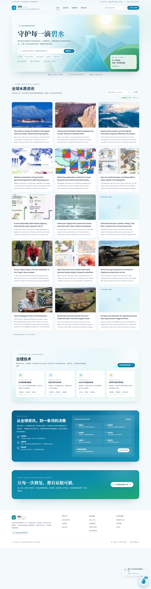
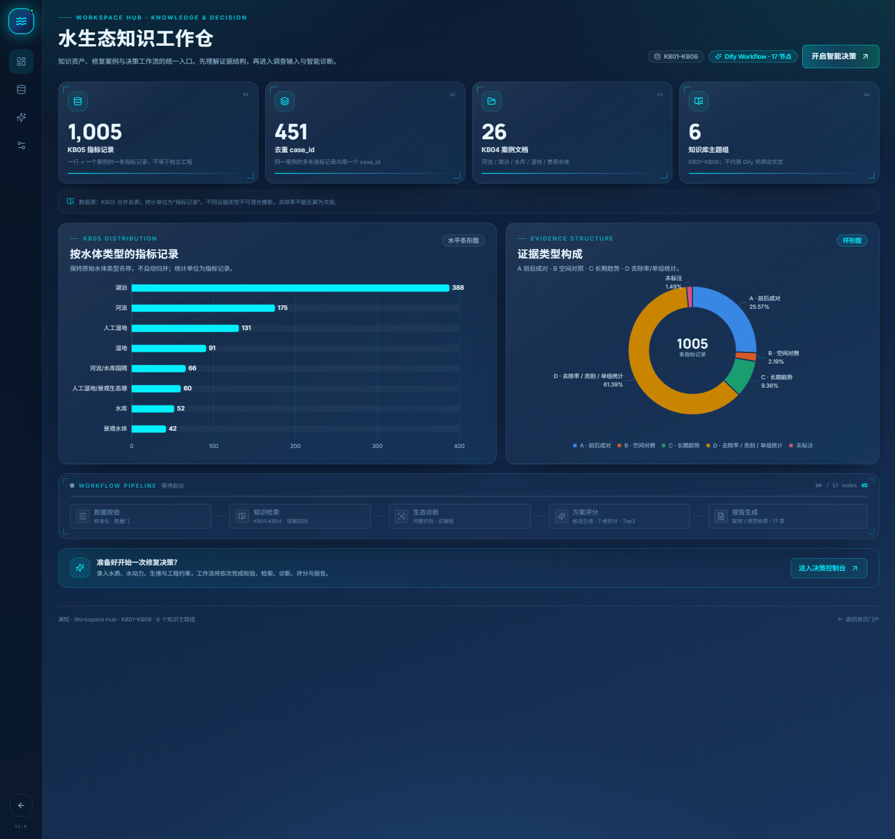
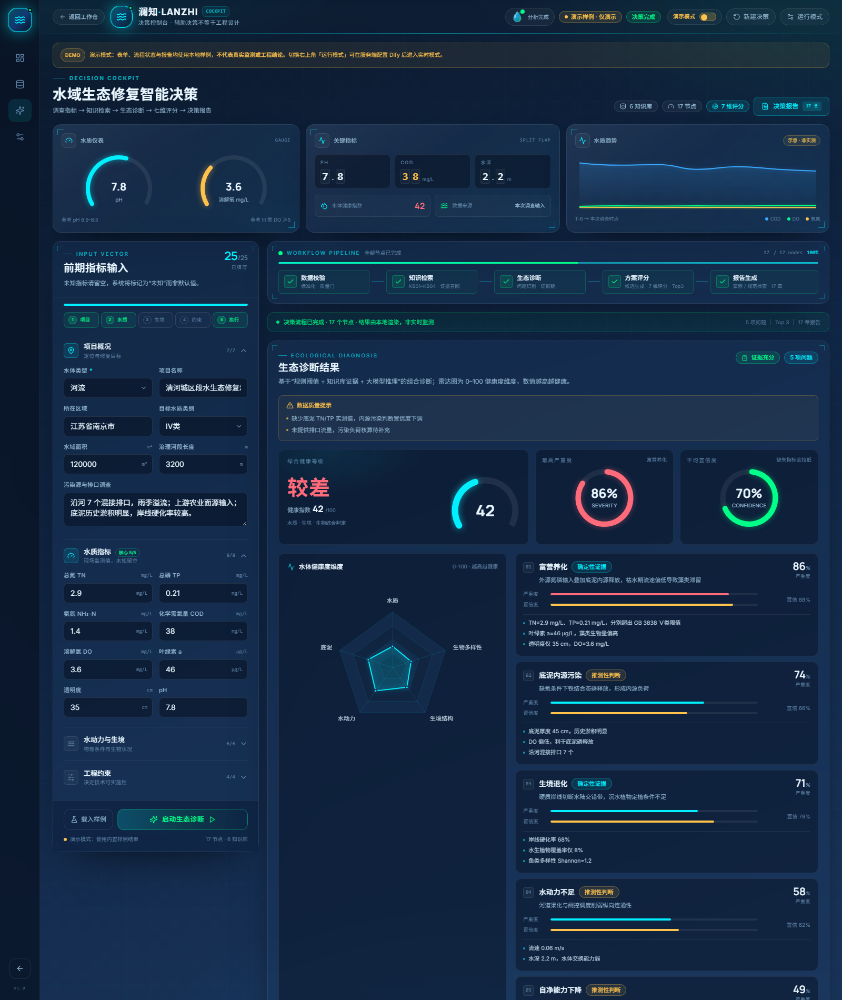
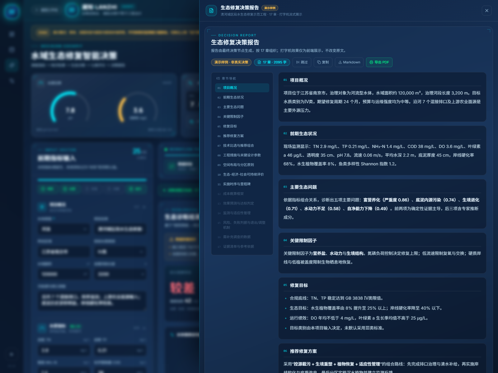
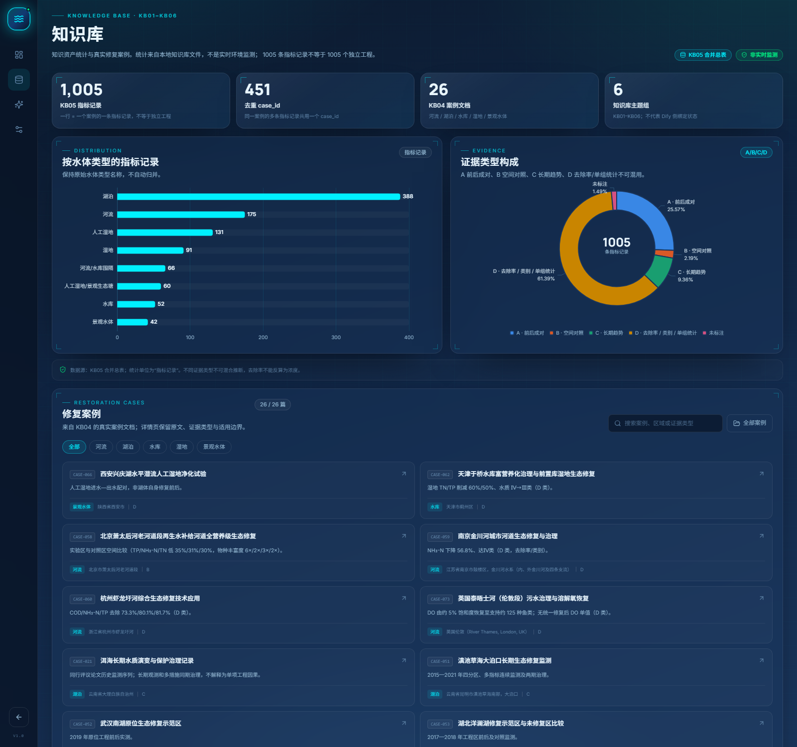
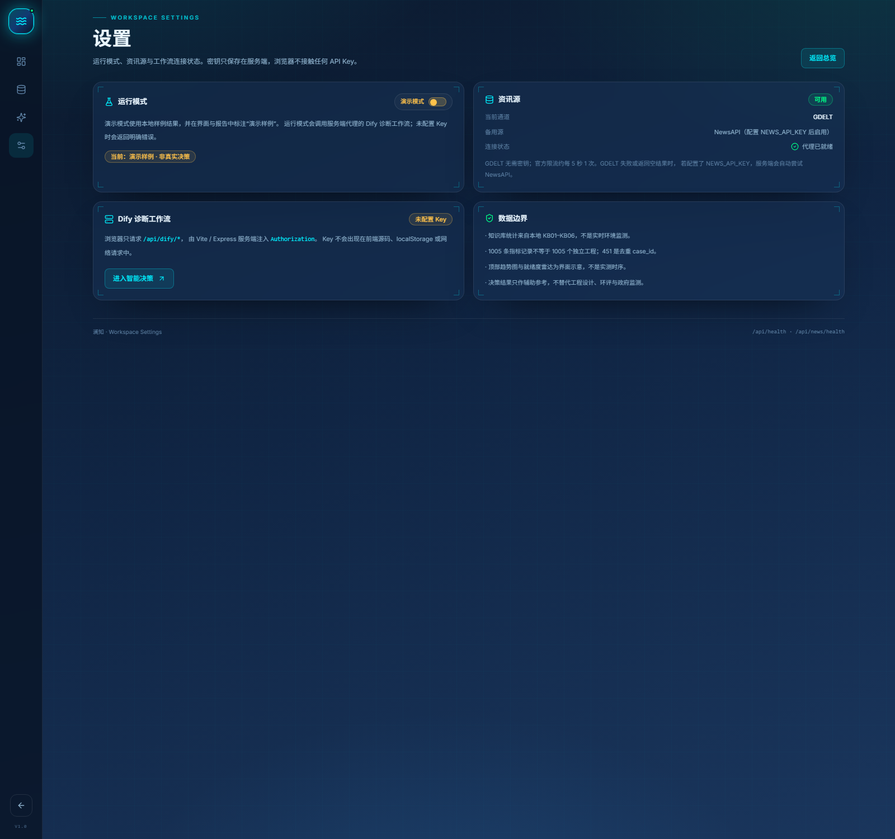

# 澜知 · 水域生态修复智能决策系统

> **Portal 资讯门户 → Workspace Hub 工作仓 → Decision Cockpit 决策执行界面**  
> 浅色全球水质资讯门户，点击右下角「小澜」水滴机器人进入深蓝工作仓，再开启决策控制台。



> 预览中的资讯来自公共 RSS 源（The Guardian / ScienceDaily / Phys.org / Circle of Blue），版权归原媒体；实际内容以原文为准。

| 工作仓首页 | 决策执行界面 | 决策报告抽屉 |
| --- | --- | --- |
|  |  |  |

| 知识库 | 设置 |
| --- | --- |
|  |  |

---

## 1. 三层视图

| 层级 | 路由 | 定位 |
| --- | --- | --- |
| 门户资讯页 | `/` | 浅色、极简；全球水质/环保新闻流；合规外链 |
| 工作仓首页 | `/workspace` | 知识资产 + 工作流入口；4 个 KPI、水体类型条形图、证据环形图、流程状态 |
| 知识库 | `/knowledge` | 指标卡片 + 环形图 + 柱状图 + 修复案例列表；不含决策表单 |
| 决策执行界面 | `/assistant` | 参数输入 + 顶部数据看板 + 节点流动 + 雷达/仪表盘/柱状图 + 报告抽屉 |
| 设置 | `/settings` | 运行模式、资讯源、Dify 连接状态与数据边界 |

```text
门户站 ──点击小澜──▶ /workspace ──点击“开启智能决策”──▶ /assistant
   ▲                     │                                  │
   └──── 返回门户 ◀──────┘◀────────── 返回工作仓 ◀──────────┘
```

- 小澜悬浮入口只进入 `/workspace`，不再直接跳到决策台。
- `/system` 兼容旧链接，重定向到 `/workspace`。
- 工作仓左侧导航：**总览、知识库、智能决策、设置**。

## 2. 门户资讯页

### 2.1 公共新闻 API 优先级

```
浏览器 → GET /api/news?q=...&max=12
              └─ Vite 开发中间件 / Express 生产路由
                    ├─ 1. GDELT DOC API（默认，免费无密钥）
                    ├─ 2. NewsAPI everything（可选备用，需 NEWS_API_KEY）
                    ├─ 3. 公共 RSS（默认开启，免费无密钥）
                    └─ 4. Dify 新闻工作流（可选，NEWS_PROVIDER=dify）
```

- **GDELT**：`https://api.gdeltproject.org/api/v2/doc/doc`
  - `mode=artlist&format=json&sort=datedesc`
  - 官方限流约 **每 5 秒 1 次**；代理内置串行队列、6 秒间隔与一次 429 重试。
  - GDELT 的 `artlist` 不返回摘要，前端会显示“该公共新闻接口未返回摘要，点击查看原文”，不伪造内容。
- **NewsAPI**：配置 `NEWS_API_KEY` 后，在 GDELT 失败或返回空结果时自动作为备用源。
- **公共 RSS**：默认开启，内置 ScienceDaily · Water、The Guardian · Water、Phys.org · Environment、Circle of Blue。GDELT 限流或超时时会自动切换，只展示标题/摘要/来源并跳转原文。
- **Dify 工作流**：设置 `NEWS_PROVIDER=dify` 与 `DIFY_NEWS_API_KEY` 后启用。

```bash
# .env
NEWS_PROVIDER=gdelt
NEWS_API_KEY=                 # 可选，NewsAPI 备用
GDELT_BASE_URL=https://api.gdeltproject.org/api/v2/doc/doc
NEWS_DEFAULT_QUERY=water pollution OR water quality OR river restoration OR wetland restoration

# 公共 RSS 备用（免费、公开、无需密钥）
NEWS_RSS_ENABLED=true
# NEWS_RSS_FEEDS=[{"url":"https://www.theguardian.com/environment/water/rss","name":"The Guardian · Water"}]
NEWS_RSS_FEEDS=
```

### 2.2 展示与版权

- 站内只展示：**封面、标题、摘要、来源**。
- 点击卡片使用：

```tsx
<a href={article.url} target="_blank" rel="noopener noreferrer">
  ...
</a>
```

- 不在本站转载全文，不提供站内全文详情页。
- 没有有效外链的条目会在服务端被过滤。
- 资讯流使用 CSS Grid + `auto-rows-fr`，卡片等宽等高；标题 `line-clamp-2`，摘要 `line-clamp-3`。
- 治理技术 4 张等宽等高卡片，点击进入工作仓 `/knowledge`。
- 加载中展示 6 张 Skeleton；错误展示可读原因和「重新获取」。
- 前端请求带 `AbortController` 超时（默认 25s，兼容 GDELT 18–21s 响应）、指数退避重试（最多 2 次）和友好错误文案。
- 检索词少于 5 个字符会在前端/服务端同时拦截，避免 GDELT `InvalidParameter`。

> Dify 工作流内调用 GDELT 的 HTTP Request 节点配置见
> [docs/dify-gdelt-http-node.md](docs/dify-gdelt-http-node.md)。

## 3. 工作仓首页

核心文件：[WorkspaceHubPage.tsx](src/pages/WorkspaceHubPage.tsx)

- 统一工作仓外壳：左侧 76px 导航（总览/知识库/智能决策/设置），底部返回门户。
- 顶部 4 个真实 KPI（KB05）：
  - `1,005` 条 KB05 指标记录
  - `451` 个去重 `case_id`
  - `26` 篇 KB04 案例文档
  - `6` 个知识库主题组
- 左：ECharts 横向条形图「按水体类型的指标记录」。
- 右：ECharts 环形图「证据类型构成」，中心显示总记录数。
- 底部：复用 `PipelineRail` 展示工作流五阶段状态。
- 右上角「开启智能决策」进入 `/assistant`。

> 统计口径：1005 是指标记录数，不等于独立工程数量；451 是去重 case_id，不等于 451 个工程。

## 3.1 知识库页面

核心文件：[KnowledgePage.tsx](src/pages/KnowledgePage.tsx)

- 指标卡片：1,005 / 451 / 26 / 6。
- ECharts 横向条形图：按水体类型的指标记录。
- ECharts 环形图：证据类型构成，中心显示 1005。
- 修复案例列表：26 篇 KB04 案例，支持水体类型筛选、关键词搜索，点击进入案例详情。
- 不包含决策输入表单。

## 4. 决策执行界面

核心文件：[AssistantPage.tsx](src/pages/AssistantPage.tsx)

- **顶部状态栏**：返回工作仓、演示/运行模式切换开关、新建决策、运行设置、节点进度。
- **顶部数据看板**：
  - `MiniGauge`：pH、溶解氧仪表盘；
  - `FlipNumber`：pH、COD、水深数字翻牌器；
  - `SparkLine`：动态缩略折线图。
- **左侧输入**：25 项 DSL 表单，分组折叠；核心五项至少填写 3 项。
- **中央工作流**：数据校验 → 知识检索 → 生态诊断 → 方案评分 → 报告生成。
- **生态诊断**：健康度维度雷达（水质/底泥/水动力/生境/生物多样性）、健康仪表盘、严重度/置信度环形图。
- **技术比选**：Top 3 卡片 + 横向柱状图 + 七维雷达。
- **报告**：右侧抽屉，Markdown + 打字机流式输出。

## 5. 视觉规范

### 门户站（Light）

| 角色 | Token | 色值 |
| --- | --- | --- |
| 页面底色 | `portal-bg` | `#F4F9FC` |
| 卡片 | `portal-surface` | `#FFFFFF` |
| 浅色区块 | `portal-mist` | `#F0F7FA` |
| 边框 | `portal-line` | `#DCEAF1` |
| 主文字 | `portal-ink` | `#0D2B3E` |
| 正文 | `portal-body` | `#486273` |
| 品牌水蓝 | `portal-brand` | `#0B7EA8` |
| 水色 | `portal-water` | `#119BD1` |
| 生态绿 | `portal-leaf` | `#1FA971` |

字体：`Noto Serif SC`（Hero）+ `Manrope`（数字/标题）+ `Inter` + `Noto Sans SC`（正文）。

### 工作仓 / 决策台（Dark）

| 角色 | Token | 色值 |
| --- | --- | --- |
| 底色渐变 | `deepsea-900 → 700` | `#0B192C → #1A365D` |
| 青色霓虹 | `tech-cyan` | `#00F0FF` |
| 绿色霓虹 | `tech-green` | `#00FF88` |
| 科技蓝 | `tech-blue` | `#3BA9FF` |
| 玻璃面板 | `.glass` | `rgba(26,54,93,.42)` + blur |
| 警示 / 错误 | `tech-amber / tech-red` | `#FFC24B / #FF6B7A` |

圆角：卡片 16px，按钮/输入 8–10px；图表色序 `#00F0FF → #00FF88 → #3BA9FF`。

## 6. 快速开始

```bash
cd web
npm install
cp .env.example .env.local
npm run dev          # http://localhost:5173
```

生产：

```bash
npm run build
npm start            # http://localhost:8787
```

- 开发模式 Vite 中间件直接处理 `/api/news`，并代理 `/api/dify/*`。
- 生产模式由 `server/index.mjs` 托管 `dist/` 与 API。
- `.env` 自动加载，`.gitignore` 已忽略真实密钥文件。

## 7. Dify 诊断工作流

```bash
DIFY_BASE_URL=https://api.dify.ai
DIFY_API_KEY=app-...
```

> 默认进入**运行模式**。未配置 `DIFY_API_KEY` 时，运行会提示明确错误；
> 可在决策台右上角或 `/settings` 切换回**演示模式**。

```
浏览器 → POST /api/dify/v1/workflows/run
             └─ Vite / Express 代理（服务端注入 Bearer Key）
                   └─ Dify Workflow
                         └─ outputs.final_report / diagnosis / top3
```

前端 [dify.ts](src/lib/dify.ts) 解析 SSE：

```ts
const reader = response.body!.getReader()
// 逐行 data: {...}
// node_started / node_finished → 点亮真实节点
// workflow_finished → outputs.final_report / diagnosis / top3
```

`diagnosis` 可选返回健康度维度：

```json
{
  "water_health_grade": "较差",
  "health_dimensions": [
    { "dimension": "水质", "score": 38 },
    { "dimension": "底泥", "score": 46 },
    { "dimension": "生物多样性", "score": 35 }
  ],
  "problems": []
}
```

有 `health_dimensions` 时使用健康度雷达；否则回退到问题严重度/置信度雷达。

## 8. 目录

```
web/
├─ server/
│  ├─ index.mjs              Express：.env、/api/news、/api/dify、静态托管
│  └─ news.mjs               GDELT / NewsAPI / Dify 新闻代理
├─ src/
│  ├─ pages/
│  │  ├─ HomePage.tsx        门户资讯页
│  │  ├─ WorkspaceHubPage.tsx 工作仓首页
│  │  ├─ KnowledgePage.tsx   知识库（统计 + 案例列表）
│  │  ├─ AssistantPage.tsx   决策执行界面
│  │  ├─ SettingsPage.tsx    设置
│  │  └─ …                   Cases / About
│  ├─ components/
│  │  ├─ portal/             导航、Footer、Hero SVG、资讯卡片与资讯流
│  │  ├─ workspace/          WorkspaceShell / Sidebar、TopDashboard
│  │  ├─ mascot/WaterSprite  小澜水滴机器人 + 全屏转场
│  │  ├─ charts/             ECharts 封装、雷达、仪表盘、环形、折线
│  │  ├─ ReportDrawer.tsx    报告侧边抽屉
│  │  └─ …                   表单、流程、诊断、技术、报告
│  ├─ hooks/useNews.ts       资讯请求、防抖、取消、重试
│  ├─ hooks/useWorkflow.ts   SSE 状态、节点进度、中止/重试
│  ├─ lib/news.ts            资讯客户端（超时/退避/字段映射）
│  └─ lib/settings.ts        运行模式持久化
├─ docs/                     预览截图 + Dify GDELT 节点配置
├─ .env.example
└─ 一键启动.bat
```

## 9. 验收对照

| 验收项 | 状态 |
| --- | --- |
| 门户浅色资讯页 + 导航 + 搜索 | 已实现 |
| GDELT 免密钥资讯 + NewsAPI / 公共 RSS 备用 | 已实现；GDELT 限流时自动切换 RSS，实测返回 6 条真实资讯 |
| 前端超时 + 指数退避 + 友好文案 | 已实现（默认 25s，最多 2 次重试） |
| 检索词 ≥ 5 字符校验 | 前端 + 服务端双重校验 |
| 合规外链：只展示封面/标题/摘要/来源 | 已实现（`target="_blank"`） |
| Grid 等宽等高资讯卡片 | 已实现（`auto-rows-fr`，实测 6 卡同高 460px） |
| 治理技术 4 卡 → 知识库 | 已实现 |
| Skeleton + 错误重试 | 已实现 |
| 小澜 → 工作仓动画转场 | 已实现 |
| 工作仓左侧导航：总览/知识库/智能决策/设置 | 已实现 |
| 工作仓 4 KPI + 横向条形图 + 环形图 | 已实现 |
| 知识库：统计 + 案例列表，无决策表单 | 已实现 |
| 工作仓流程状态 + 开启智能决策 | 已实现 |
| 决策台顶部仪表盘/翻牌器/折线 | 已实现 |
| 节点流动动画 | 已实现 |
| 健康度雷达 / 严重度环形 / Top3 条形图 | 已实现 |
| 报告抽屉 + Markdown + 打字机 | 已实现 |
| Dify Key 不进浏览器 | 已实现（服务端代理） |

## 10. 已知边界

- GDELT 对同一 IP 有约 5 秒 1 次的限制；代理已串行排队。共享出口 IP 触发 429 时，服务端会自动切换 NewsAPI（若配置）或公共 RSS，确保资讯区有内容。
- RSS 内容来自原媒体的公开订阅源，本站只展示标题/摘要并外链，不转载全文；不同媒体的更新频率与摘要长度不同。
- 前端默认超时 25s（GDELT 实测可能 18–21s），并做最多 2 次指数退避重试；可用 `VITE_NEWS_TIMEOUT_MS` 调整。
- GDELT `artlist` 不提供摘要与部分封面，前端会如实提示，不编造摘要。
- 顶部趋势图与数据就绪度雷达为界面示意，不是实测时序或诊断结论。
- 尚未提供已发布 Dify App 的真实 Key 与成功执行记录；需配置后实测。
- PDF 使用独立打印视图（浏览器「另存为 PDF」）。

## 11. 参考

- [GDELT DOC 2.0 API](https://blog.gdeltproject.org/gdelt-doc-2-0-api-debuts/)
- [NewsAPI](https://newsapi.org/docs)
- [Dify Workflow App API](https://docs.dify.ai/en/api-reference/guides/workflow)
- [Apache ECharts](https://echarts.apache.org/)
- [Framer Motion](https://www.framer.com/motion/)
